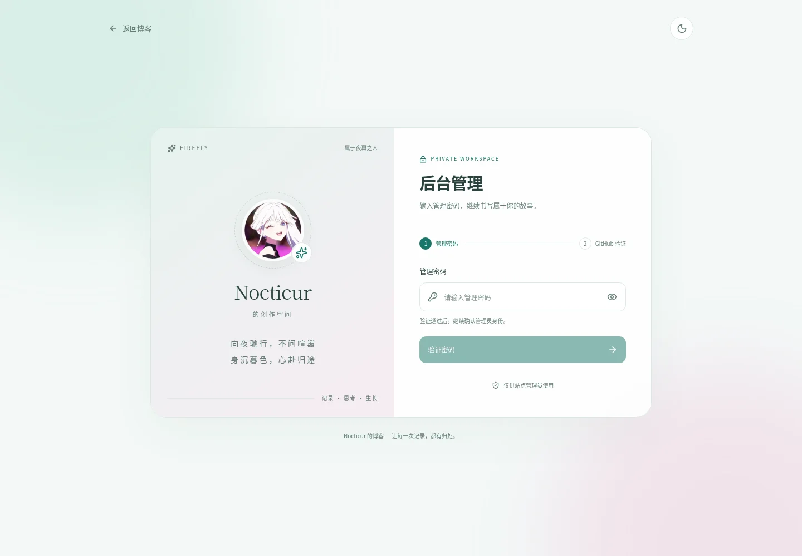
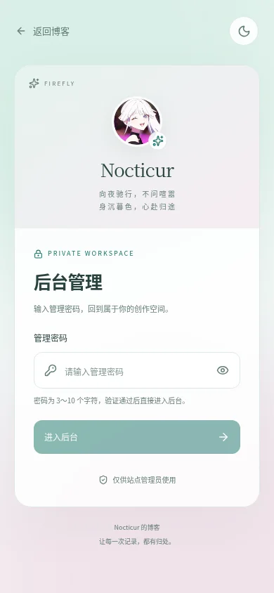
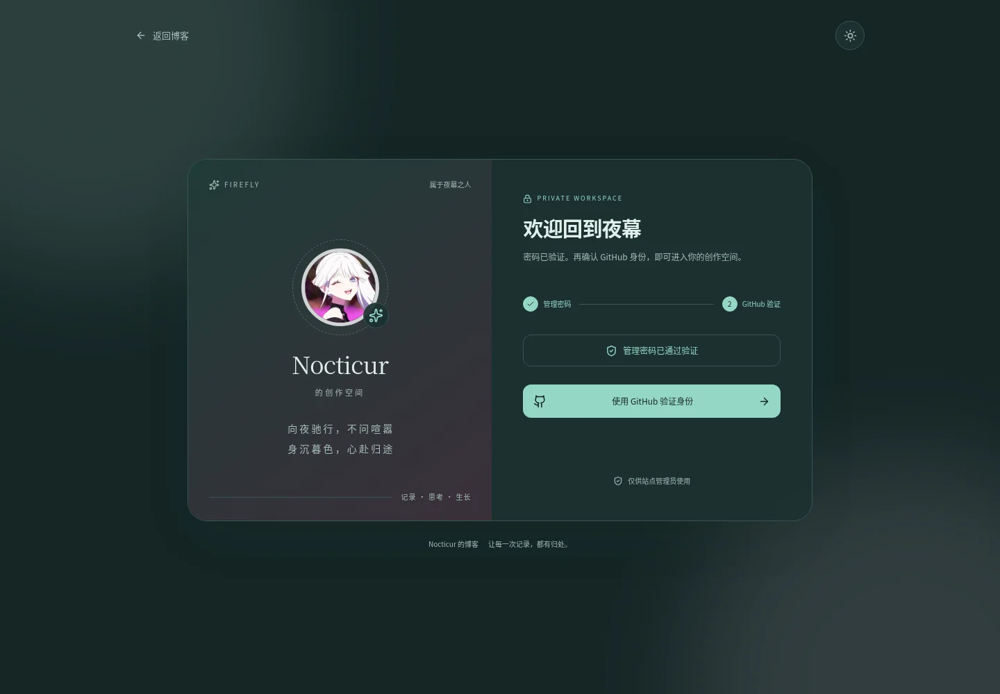

# 后台密码入口与免费部署验收

2026-10-11，基于安全复审提交 `a8dab61228355c502ce3c46bf878e0cace13a7cc` 增加后台入口。原安全复审压缩包保存的是此前快照，本次源码、截图和记录通过 Git 提交交付。

## 入口与页面

博客作者卡片增加“后台管理”按钮，手机导航菜单提供相同入口，目标固定为 `https://admin.mourn.top/`。进入页沿用原头像和两行签名，采用淡青与柔粉背景、圆角卡片；支持手机、深浅主题、密码显示切换、回车提交和错误提示。头像缩略图由原 PNG 生成 256×256 WebP，约 17 KiB；原 PNG 字节未改。

## 密码与认证边界

在 **Vercel 管理项目**设置 `ADMIN_ENTRY_PASSWORD`，至少 12 个字符、UTF-8 不超过 256 字节，建议 16 位以上随机密码；不加 `PUBLIC_` / `VITE_` 前缀，保存后重新部署管理项目。Preview / Development 使用不同的测试密码。没有配置、过短、全空格或超长时入口关闭，没有默认生产密码。

`POST /api/auth/entry` 必须来自管理同源，仅接受有限大小的 JSON，服务端进行恒定时间校验。成功后设置 `__Host-admin-entry` Cookie：Secure、HttpOnly、SameSite=Lax、Path=/，有效期 12 小时。Cookie 带随机 nonce、到期时间和 HMAC；签名密钥由密码和站点/环境/域名经过 scrypt 派生，不需要新增数据库迁移。签名校验不会向前端提供密码或密码摘要；密码不放入数据库、Git、构建静态资源或浏览器存储。

密码通过后仍须 GitHub OAuth 验证管理员数字 ID `285582250`。OAuth 发起、回调以及所有管理认证请求均检查入口凭证，已有 GitHub 会话也不能跳过新密码。管理写请求继续校验 Origin 与 CSRF；第三方签名回调和 Cron 保留各自认证。退出登录撤销数据库会话并清除两种 Cookie。更换密码并重新部署后旧入口凭证失效。

密码与 OAuth 使用不同命名空间的 PostgreSQL 持久限流；每个 IP 每 10 分钟最多 5 次尝试，站点每个窗口最多 100 次，计数受事务锁保护，数据库只保存 IP 的 HMAC 摘要。生产只接受 Vercel 的受信转发地址，不使用可伪造的普通转发头。入口状态查询不连接数据库；未持有认证 Cookie 的私有请求在读取业务数据前被拒绝。

## 本地验证

- 后台完整测试 **179 通过、0 失败、0 跳过**；新增 18 项包含父测试的密码与数据库验证，覆盖错误密码、配置缺失、Origin/正文限制、Cookie 伪造/过期/轮换/隔离、旧会话、注销、OAuth 绕过、非管理员身份和并发限流。
- Astro 检查 **272 文件，0 errors / warnings / hints**；根与后台 TypeScript 检查通过。
- 发布清单测试 **13/13**；完整博客构建 **42 路由、15 篇公开文章、33 个 Pagefind 文件**；Nitro Vercel 构建成功，生成 **20 steps / 3 workflows**。
- 实际编译后的 Vercel Node 产物通过 5 项本地检查；数据库仍为 **16 条管理记录、15 篇公开文章**。
- 密码入口 **9 项浏览器检查通过**，覆盖真实错误/正确密码、Cookie 属性、密码单独不能读取管理接口、旧会话补做密码、注销、320/390 px 手机宽度、深色主题，以及桌面/手机博客入口。
- 原有 9 个后台页面、8 项编辑器交互、6 项安全浏览器检查和 12 项订阅/搜索检查继续通过，无页面运行错误。
- 原 14 个文章文件、迁入两篇除新增 slug 外的源文件、原头像和四条模板动态保持此前核验字节。
- 前端静态产物检索未发现 `ADMIN_ENTRY_PASSWORD` 或本地合成测试密码；没有新增依赖或修改锁文件。
- GitHub CI YAML 解析通过，保留全部检查；构建产物仅保留 1 天并使用高压缩率，减少私有仓库免费存储额度的占用。

本地凭证是隔离测试凭证；GitHub OAuth 端到端服务端协议使用受控响应，没有调用真实生产 OAuth。截图不包含密码、Cookie 或会话文件。测试日志在当前云工作区 `/workspace/.firefly-environment/`，其中 `browser-entry.json` 保存 9 项结果；会话文件不交付。

## 免费部署与线上状态

按 [免费部署说明](./free-deployment.md) 选择 Vercel Hobby、Neon Free 和可选服务的 Free 计划，不购买或升级套餐；邮件、云备份及正式发布开关继续默认关闭。项目使用用户已有域名，域名原有续费不由代码决定。

实际平台凭据、套餐、数据库和域名尚未接入，本次未创建生产部署或计费服务。官方定价页面被当前出站策略拒绝访问，具体免费额度及相关产品在当前账户中的免费权限仍需查看平台说明；不能承诺无限免费容量。完整平台验收仍按 [acceptance.md](./acceptance.md) 执行。
